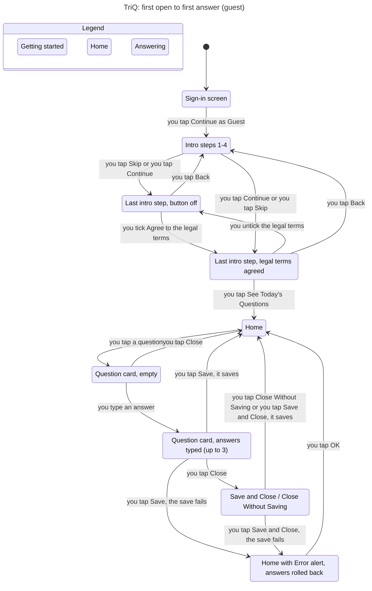
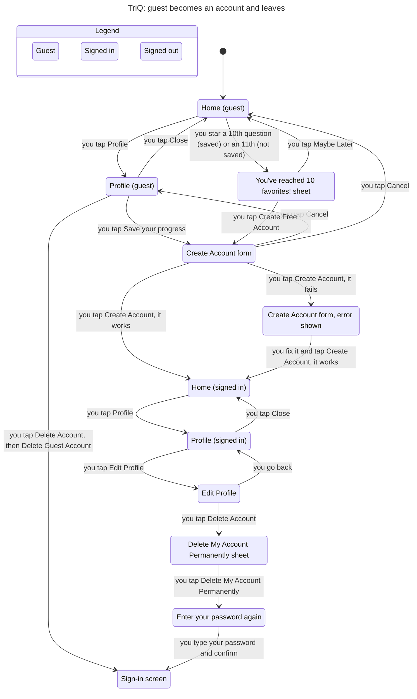
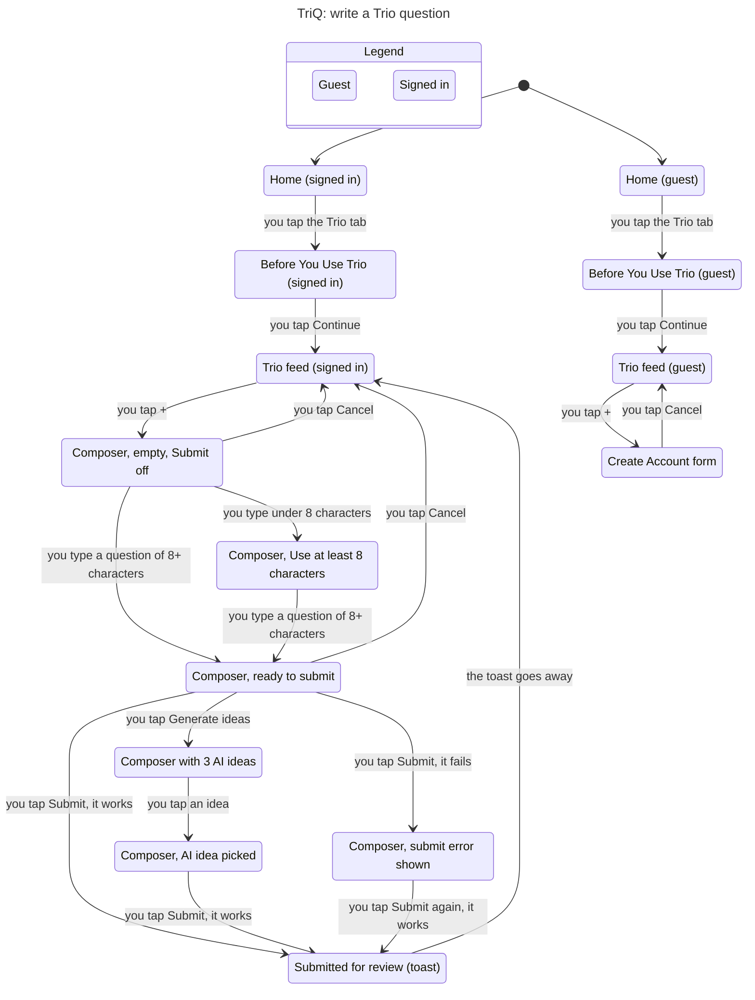

# TriQ user flows
Statecharts of the most important user flows, checked with TLA+ (TLC) and drawn with the `/statechart` skill on 2026-11-12. Each state is what the user sees; each arrow is what the user does. Every rule listed holds in the model. The models are read from the feature files of the verify skill and the code; they are not proof of the app (the verify skill is).
Make a chart again from its folder: `TLA2TOOLS=~/.local/share/tlaplus/tla2tools.jar ~/.claude/skills/statechart/scripts/statechart <Spec>.tla --config <Spec>.cfg --view view.mjs --out out`.

## First open to first answer

Rules and paths: [`1-first-answer/report.md`](1-first-answer/report.md).

## Guest becomes an account and leaves

Rules and paths: [`2-guest-account/report.md`](2-guest-account/report.md).

## Write a Trio question

Rules and paths: [`3-trio-question/report.md`](3-trio-question/report.md).
